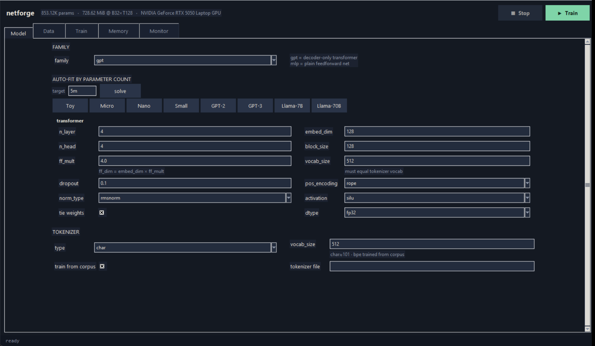
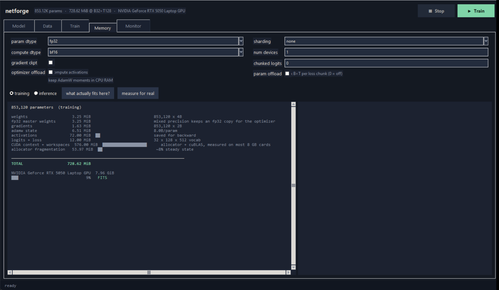
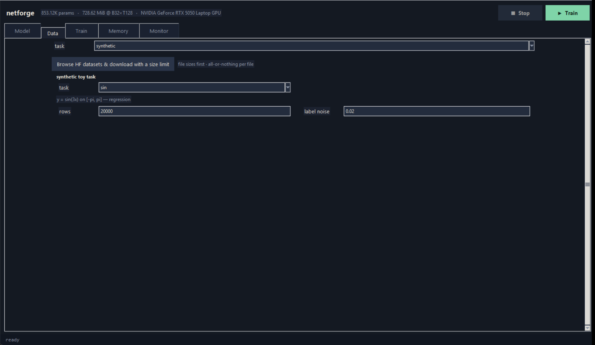
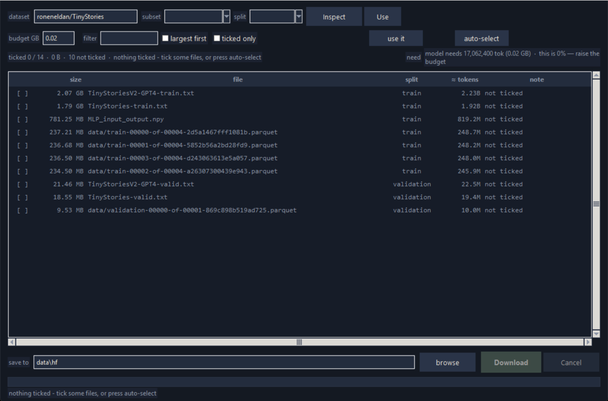

# netforge

A graphical neural network trainer that spans **41 parameters to 70 billion**,
with an analytic memory model you can query before you allocate anything.



Inspired by [`tinyllm`](https://github.com/notcpu/tinyllm) — same flat-module layout,
same `run_cfg`-as-single-source-of-truth idea, same defensive
`try/except: pass` everywhere — but built around three things tinyllm does not
have: a second model family for genuinely tiny nets, a memory model you drive
from the GUI, and hard data budgets.

---

## Install

```bash
pip install torch numpy matplotlib pillow psutil
pip install datasets          # optional, for HuggingFace
```

Everything else is stdlib. Python 3.10+.

## Run

```bash
python netforge.py             # the GUI
python netforge.py train --solve 5m     # 5M-param GPT, no config file needed
python netforge.py solve 7b             # architecture for a parameter target
python netforge.py memory --config x.json
python netforge.py fit                  # what fits on this machine
python netforge.py device
```

## Two model families, one trainer

| | family | shape | param range |
|---|---|---|---|
|  | `mlp` | plain feedforward, regression or classification | 41 → 500M |
|  | `gpt` | decoder-only transformer, KV-cached generation | 300 → 70B+ |

Both expose `forward(x, targets) -> (out, loss, kv)` and are driven by the same
loop. From the optimizer step onward the training loop does not branch at all.

**Very tiny nets are a first-class case, not an edge case.** The Data tab ships
procedural toy tasks (sin, xor, moons, spiral, blobs) so you can train a
37-parameter MLP on synthetic data with zero downloads and zero setup. The arch
solver goes down to 41 parameters.

## The memory model

`memory.py` is closed-form arithmetic — no model is ever instantiated, so it
works for a 70B config you could not possibly build. It accounts for weights,
fp32 master weights, gradients, optimizer state, per-layer activations, the
logits tensor, KV cache, CUDA context, and allocator fragmentation; then divides
by `num_devices` for DDP / ZeRO-2 / ZeRO-3 / FSDP.



**`measure for real`** allocates the model, builds the optimizer, runs one full
forward+backward, and compares the allocator's peak against the prediction. On
an RTX 5050 the analytic estimate lands within ~5% of measured.

The activation term is derived from the actual autograd graph with
`scaled_dot_product_attention`, which stores q/k/v/output and a logsumexp row
but *not* the S×S matrix. That distinction matters: the naive O(B·H·T²) estimate
tells you a 4k-context model needs 60 GB when it needs 6.

```bash
$ python netforge.py solve 7b
gpt: 6,976,458,752 params (-0.3%)  34L x 4096d x 64h, ctx 512, vocab 32000

7B, fp32 weights, bf16 compute, batch 1 × seq 4096, training:
    weights                  25.99 GiB
    fp32 master weights      25.99 GiB
    gradients                13.00 GiB
    adamw state              51.98 GiB
    activations              19.12 GiB
    logits + loss           750.00 MiB
    CUDA context + workspaces 1.00 GiB
    allocator fragmentation  11.03 GiB
    TOTAL                   148.83 GiB
  per device: 148.83 GiB of 8.00 GiB (1860%)  DOES NOT FIT
```

## Data budgets — read this before pointing it at a dataset

**The data stage is bounded by default.** This is not decorative; the first
version of this app streamed all of TinyStories (2.1M rows), wrote 1.8 GB to
disk, and built a 12 GB int64 tensor for a 40K-parameter model.

| control | default | meaning |
|---|---|---|
| `data.tokens_per_param` | `20` | the ratio the budget is computed from — Chinchilla. Lower it for a small model |
| `data.max_tokens` | `0` = **auto** | explicit override of the token budget |
| `data.max_rows` | `0` | hard cap on rows |
| `data.bytes_per_token` | `0` = measured table | override the tokens→bytes conversion |
| `data.max_gb` | `1.0` | secondary byte cap |
| `data.cache_text` | **`False`** | write the corpus to disk. Off by default; on, it streams to the file as it goes rather than holding it in RAM |

The budget is `min(params × tokens_per_param, steps × batch × ctx × 4)`,
clamped to `[50K, 50B]`. The run-length half is what actually binds — there is
no point pulling more tokens than your run will consume — and the clamp is a
runaway guard, not the main mechanism. (It was 20M before; at the measured
0.62 bytes/token that is **12 MB of corpus**, which is not a safety limit so
much as a bug.)

The Data tab shows the whole chain before you start:



```
34.88M × 20 tok/param = 697,538,560 tokens (auto) · ~3,326 MB RAM · ~0.40 GB on disk (0.62 B/token, parquet)
```

**Bytes per token is measured, not guessed.** 0.62 B/char is the C4 (English
web text, snappy parquet) ratio sampled off row-group footers; TinyStories
measures 0.52. 3.86 chars/token is byte-level BPE at vocab 8000 on the same
text. Plain `.txt` is uncompressed, so it is ~1 B/char. Override it with
`data.bytes_per_token` if your corpus is code, tables, or non-English.

How it stays bounded:

- Rows are encoded and dropped one at a time. The raw string, the Python id
  list and the final tensor never coexist.
- The token tensor is **int32**, not int64 — 4 bytes/token. That alone removed a
  third of the blowup. Batches are cast back to int64 at `get_batch`, which is
  batch-sized.
- Caching streams to the file handle instead of accumulating.
- Every tabular source (Hub, local `.parquet`, `.csv`, `.jsonl[.gz]`, `.txt`)
  goes through one shared `stream_rows_to_tokens`, so the caps behave
  identically and there is only one copy of the logic to get right. Dot-
  directories (`datasets`' own `.cache`) are skipped.

Measured, pulling TinyStories with a 500K-token budget:

```
rows read          629            (of 2,119,489 available)
tokens kept        500,000
stopped because    token cap
peak process RSS   grew 50 MB     (was 12 GB)
```

## Downloading a dataset, with a size limit

**Browse datasets & download with a size limit** (Data tab) opens a browser
that lists every file in a repo *with its size*. Nothing is ticked until you
tick it — the budget is a warning threshold, never a selector. Subset/split
boxes scope both the server-side listing (so a huge repo only walks the
subtree you asked about) and the plan, the filter narrows the view without
ever adding or dropping downloads, ticked rows stay visible no matter what
the filter says, and a `split` column shows which split each file belongs to.



**The budget starts at what your model wants.** The browser reads the current
model config, works out `params × tokens_per_param`, converts that to GB, and
pre-fills the budget box. The table has an `≈ tokens` column so you can see
what each shard is worth in training terms, not just megabytes, and the header
tells you whether your selection actually covers the target:

```
need  model needs 697,538,560 tok (0.40 GB)  ·  this is 94% — raise the budget
```

Two rules in `plan_download` that are not obvious:

- **A file is all-or-nothing.** A half-downloaded parquet is not a smaller
  dataset, it is a corrupt one. Files that don't fit the remaining budget are
  *skipped* and the table says why: `needs 237.21 MB, only 1.67 MB left`.
- **Smallest-first, not largest-first.** Filling the budget with the biggest
  files looks efficient and isn't — it buys one shard and a dataset you can't
  shuffle. At 0.05 GB against TinyStories you get 3 files covering the repo;
  largest-first would buy you 1.

**The checkboxes are the decision, full stop.** Click any row
(or its `[ ]` cell, or press space) to tick/untick it. The summary counts
`ticked N / total`, goes `OVER your budget` if you picked more than the budget
allows, and the Download button asks before it goes ahead anyway. `auto-select`
opts back into budget-driven picking. `ticked only` isolates your selection
when the list is long.

TinyStories is **7.10 GB** on the Hub. What each budget buys under
`auto-select`:

| budget | files | bytes | skipped |
|---|---|---|---|
| 0.05 GB | 3 | 49.5 MB | 7 |
| 0.2 GB | 3 | 49.5 MB | 7 |
| 1.0 GB | 7 | 994 MB | 3 |
| 5.0 GB | 9 | 3.53 GB | 1 |

## Held-out eval — the eval number finally means something

`evaluate()` used to sample the training corpus, so eval loss was train loss
with extra steps. Now training holds out real data: validation shards you
downloaded (routed by filename), the repo's validation split when streaming,
or the corpus tail when neither exists. Small runs skip the holdout and fall
back to train batches, and the log says which one you got. Tabular tasks hold
out the last 10% of rows.

Very large repos (C4 is 72,167 files) are listed with a cap and flagged
`partial` rather than silently showing you 3,000 of 72,000 and doing the budget
arithmetic on a fiction. Parquet footers give exact row counts without reading
the data, so shard sizing is cheap.

The destination is created and checked for free space before the first byte
moves, a disk-cache warning appears if it will not fit, and `Cancel` stops at
the next file boundary rather than leaving a truncated shard behind. On
finish it offers to point the trainer at what it just fetched — which sets
`data_dir`, clears `hf_dataset`, and reads the `.parquet`/`.jsonl.gz` through
the same budgeted streamer as everything else.

## Architecture solving

`arch.py` does not pick the closest param count. Among candidates within a 3%
band it minimises a balance cost: head_dim of 32 or 64, depth ≈ width/64, and
an **even** head_dim (rotary embeddings rotate channel pairs, so an odd
head_dim leaves one channel unrotated).

```
target    -> shape                      params          err    head_dim
    50k ->   2L x    36d x    2h           49,716    -0.6%    18 ok
     5m ->   2L x   144d x    2h        5,106,384    +2.1%    72 ok
   124m ->   7L x  1024d x   16h      120,863,744    -2.5%    64 ok
     7b ->  34L x  4096d x   64h    6,976,458,752    -0.3%    64 ok
    70b ->  84L x  8192d x  128h   67,909,263,360    -3.0%    64 ok
```

When the target is below what any stack can reach it shrinks the vocabulary too
and says so, rather than silently returning something 300000% over target. A
32k-vocab GPT cannot have 40 parameters — the embedding alone is 128K.

## Tokens

- `char` — 101 symbols, lossless for ASCII, no training. Right choice below a
  few million parameters, where 128 tokens of context is 128 real characters.
- `bpe` — byte-level BPE trained in pure Python, zero dependencies, fully
  deterministic. Operates in latin-1 space where one character is exactly one
  byte, so merges are learned and looked up over the same alphabet. Multi-byte
  UTF-8 round-trips exactly.

## Layout

```
netforge.py            entry point
netforge/
  config.py            run_cfg: one JSON-serializable source of truth
  arch.py              model families + param-target search
  memory.py            analytic memory model + measurement
  model.py             TinyGPT + MLPNet behind one interface
  tokenizer.py         char + byte-level BPE
  dataset.py           synthetic / local .txt / CSV / HF streaming
  hfhub.py             HF file inspection + budgeted download
  hfbrowser.py         the dataset-browser window
  training.py          the loop; publishes to SharedState every iteration
  state.py             SharedState singleton - the only channel between threads
  charts.py            matplotlib canvases embedded in tkinter
  gui.py               the application
  cli.py               argparse front end
  checkpoint.py        atomic save/load + JSON sidecar
  lr_schedule.py       warmup + cosine/linear/constant/WSD
  device_utils.py      device / AMP / pinning
   logging_utils.py     thread-safe log + shutdown flag
```
Test scripts and tab screenshots were removed during cleanup; `shots/` now
holds only freshly retaken lightweight tab captures (`1_model.png`,
`3_data.png`, `4_train.png`, `5_memory.png`) — no training runs, no
downloads, no measured-memory runs were used to produce them.

## Design notes

**The GUI never trains and the training loop never draws.** They meet only at
`SharedState`, which is lock-guarded. That is why the Monitor tab is safe to
open mid-run and why closing the window kills training cleanly.

**`validate_run_cfg` returns a list of strings, never raises.** The GUI shows
them in a dialog, the CLI prints them. Same code, two front ends.

**AMP auto-disables below 1M parameters.** bf16 has ~3 significant decimal
digits; a 37-parameter model loses more to rounding than it gains from the
wider memory budget, and sits at a flat loss for the whole run. The trainer
says so when it does this.

**Checkpoints write a JSON sidecar.** `torch.load(weights_only=True)` rejects
the config dicts and RNG tuples in a full checkpoint, and `weights_only=False`
on a file from an untrusted source executes code. A sidecar makes inspection
instant and safe, and reading a 70B checkpoint's metadata no longer means
opening it.

**Screenshots on a scaled display.** Tk reports logical pixels, `ImageGrab`
crops physical ones. On this machine the scale was 1.33 and the uncorrected
grab made a correctly-laid-out form look like it was overflowing.

## Known limits

- `CharTokenizer` is ASCII-only; non-ASCII becomes `<unk>`. Use `bpe` if the
  corpus is not ASCII.
- Multi-GPU sharding is *modelled* (the memory report divides correctly) but
  not *executed* — there is no distributed launcher. Use Accelerate/FSDP.
- `fused=True` in the optimizer config needs CUDA.
- BPE training is incremental (pair postings + a lazy heap, `max_count`-style),
  so a full-corpus pass in pure Python is seconds rather than minutes; the
  corpus given to it is still capped at `max_corpus_chars` (4M default) and
  merges stop early when the corpus is too repetitive to learn more.
- Resumed runs reuse the tokenizer stored inside the checkpoint (also in the
  `.meta.json` sidecar), so embedding ids cannot drift between runs.
- Download progress is per-file, not per-byte — `hf_hub_download` gives no
  intra-file callback. The status line names the file in flight so a 1.9 GB
  shard is at least never a mystery.
- Cancelling a download takes effect at the next file boundary, not mid-file,
  for the same reason a plan is all-or-nothing.
- `bytes_per_token` is calibrated on English prose. Code, tables and
  non-English text all compress differently; set it yourself if it matters.
- Repo listings cap at 4,000 files / 45 s and report `partial` when the cap
  bites. C4 (72k files) is fine — the planner only needs the *smallest*
  shards, and those come first — but a huge repo whose small files sort late
  would not.
